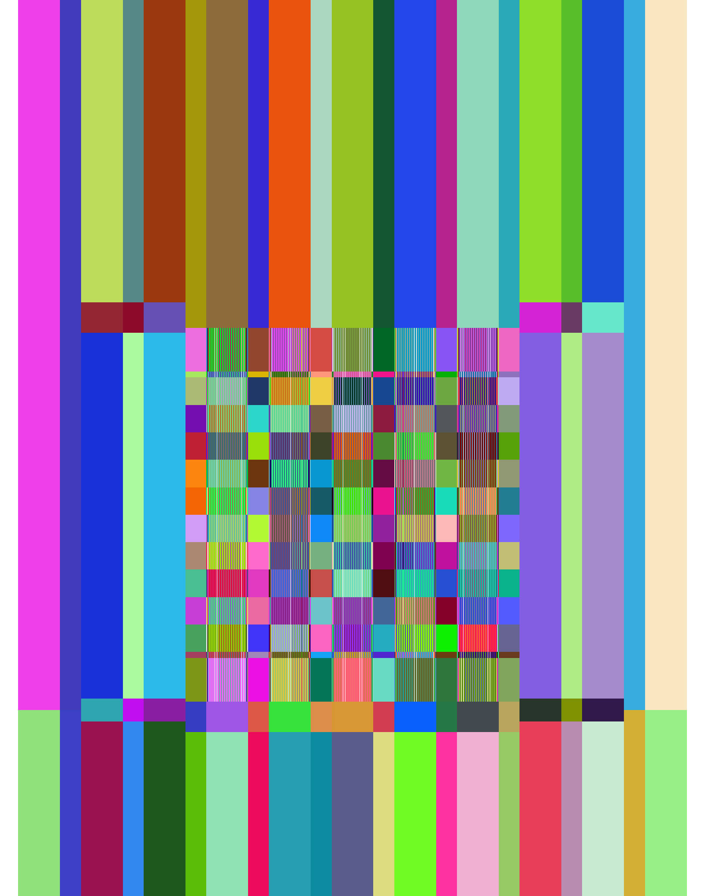
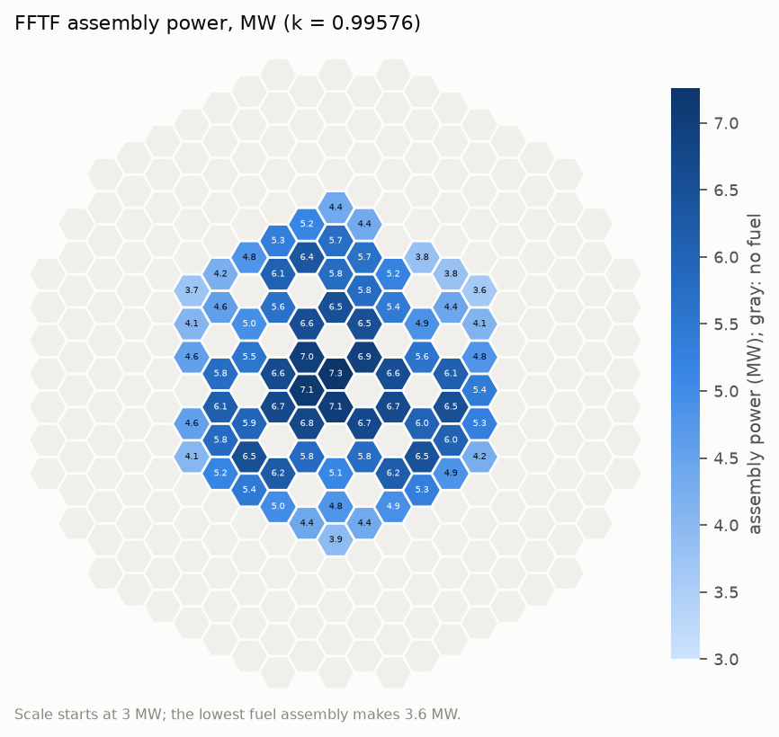
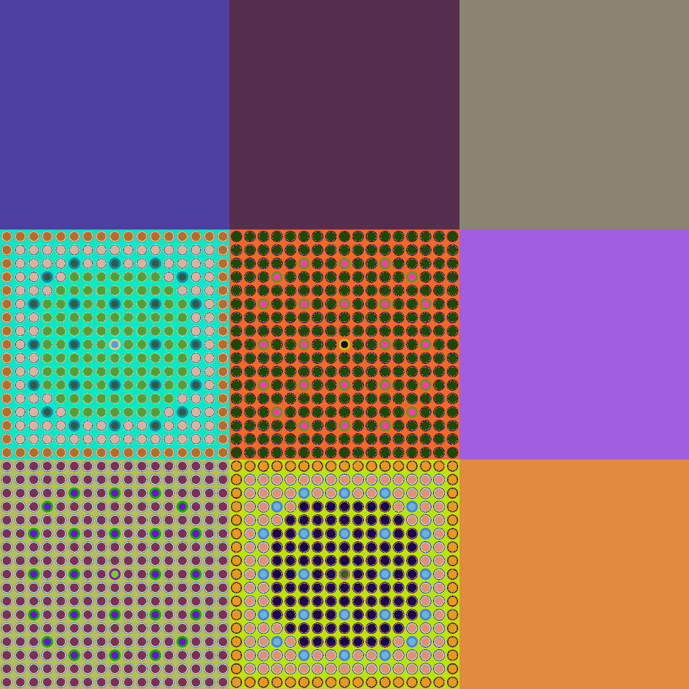
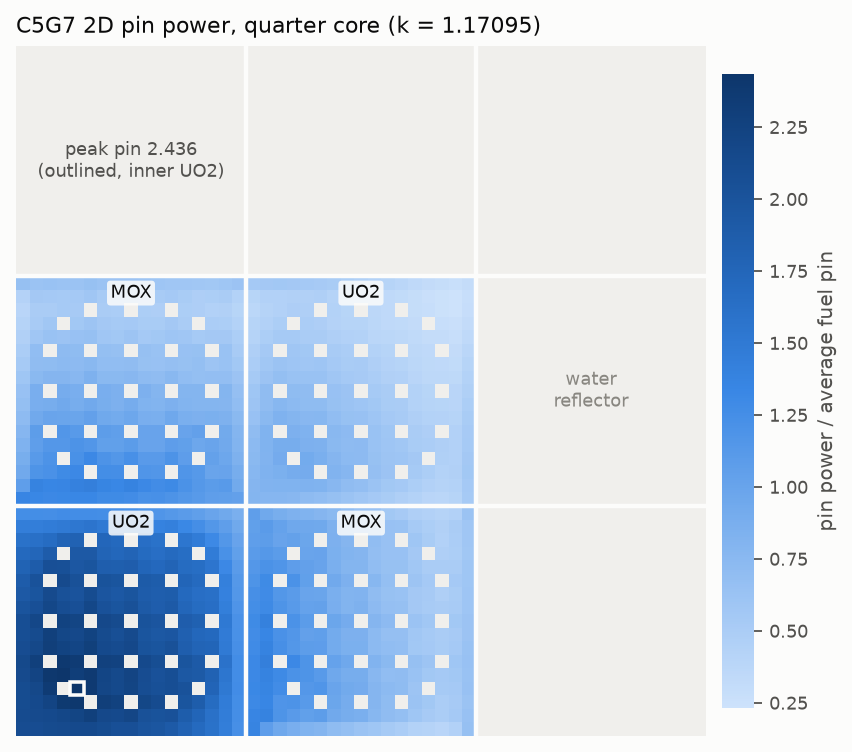
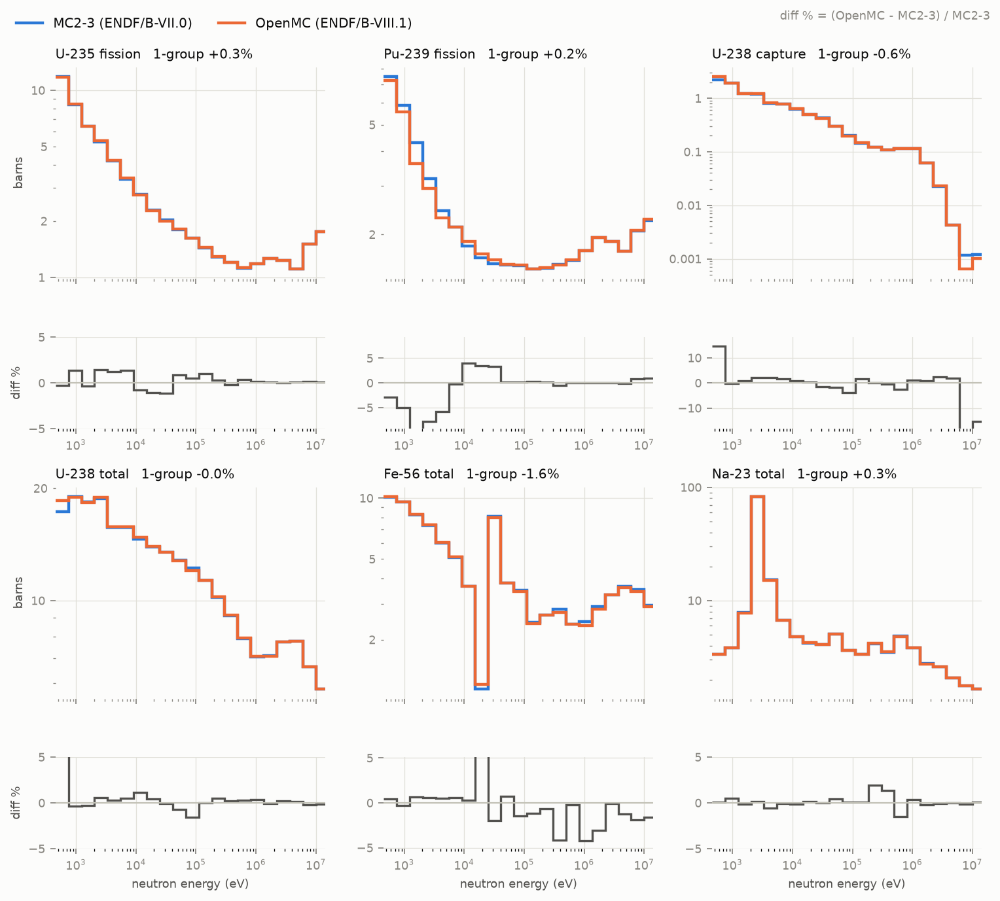
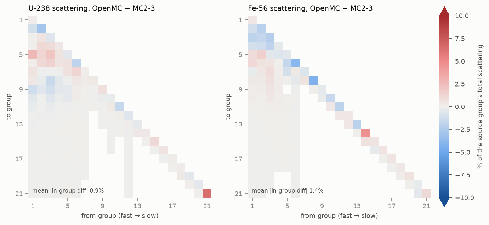
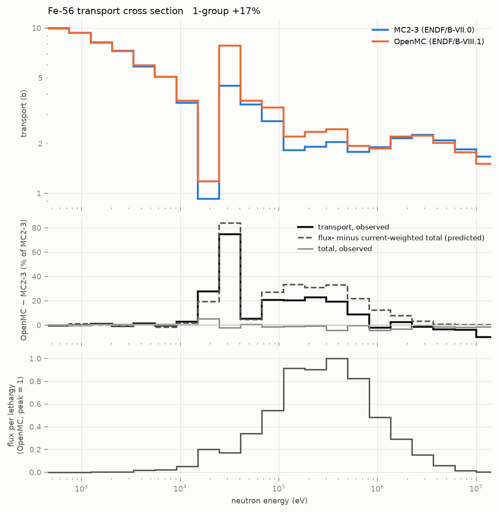

Benchmarks
==========

All runs use ENDF/B-VIII.1 and OpenMC 0.15.3. Inputs and scripts are in ``examples/``, and
``doc/make_figures.py`` redraws the figures from their outputs.

Summary
-------

.. list-table::
   :header-rows: 1
   :widths: 30 22 22 26

   * - Case
     - armi-openmc
     - Reference
     - Difference
   * - FFTF isothermal critical, k-eff
     - 0.99576 ± 0.00032
     - 0.9993 ± 0.0021 (benchmark)
     - −0.35 ± 0.21 % (C−E)/E
   * - C5G7 2D, k-eff
     - 1.17095 ± 0.00032
     - 1.18655 (MCNP, 7-group)
     - continuous energy vs 7-group (see below)
   * - C5G7 2D, assembly power (inner UO2 / MOX / outer UO2)
     - 479.4 / 217.9 / 140.8
     - 492.8 / 211.7 / 139.1
     - −2.7 / +2.9 / +1.2 %
   * - Fast-mixture ISOTXS, one-group U-235 / U-238 / Pu-239 fission
     - 1.4133 / 0.04444 / 1.6096 b
     - MC2-3: 1.4097 / 0.04395 / 1.6061 b
     - +0.3 / +1.1 / +0.2 %
   * - ISOTXS self-consistency, FFTF fuel block k-infinity
     - 1.51092 (from the ISOTXS)
     - 1.5121 ± 0.0009 (OpenMC)
     - −0.08 %

FFTF
----

The Fast Flux Test Facility isothermal critical configuration, with its control rods at the
critical positions, as described by the
`ARMI FFTF model <https://github.com/terrapower/fftf-isothermal-model>`_. The benchmark is
FFTF-LMFR-RESR-001: J. D. Bess et al., *Evaluation of the Initial Isothermal Physics
Measurements at the Fast Flux Test Facility, a Prototypic Liquid Metal Fast Breeder Reactor*,
INL/EXT-09-16524 (2010), `online <https://digital.library.unt.edu/ark:/67531/metadc1013078/>`_.
Its benchmark-model k-eff is **0.9993 ± 0.0021** (§3.1.5). Its own MCNP5 / ENDF/B-VII.0 sample
calculation gives 1.0031 ± 0.0001, (C−E)/E = +0.38 ± 0.21 % (Table 4.1.1).

The plugin models the full core from the ARMI inputs. The fuel bundles (217 pins) and absorber
bundles (61 B4C pins inside an inner duct) are drawn pin by pin, wire wraps are smeared into
the sodium, and the blocks the blueprints give as homogeneous hexagons stay that way. That is
313 assemblies, 2097 blocks and 6257 materials.

   A vertical slice through the model: each assembly keeps its own axial blocks, and fuel and
   absorber blocks show their pins.

.. list-table:: FFTF eigenvalue, 40,000 neutrons × 200 batches (50 inactive)
   :header-rows: 1
   :widths: 46 24 30

   * - Model
     - k-eff
     - Δρ
   * - Benchmark model (Bess 2010)
     - 0.9993 ± 0.0021
     -
   * - MCNP5, ENDF/B-VII.0 (Bess 2010)
     - 1.0031 ± 0.0001
     - (C−E)/E +0.38 %
   * - armi-openmc, every block homogenized
     - 0.98470 ± 0.00034
     -
   * - armi-openmc, fuel pin by pin
     - 0.99235 ± 0.00030
     - +783 pcm from fuel heterogeneity
   * - armi-openmc, fuel and absorbers pin by pin
     - **0.99576 ± 0.00032**
     - +345 pcm more from B4C self-shielding; (C−E)/E −0.35 %

The pin-by-pin result is 0.35 % below the benchmark, within twice the benchmark's 0.21 %
uncertainty. Three differences from the benchmark model remain and are not separated here:

* the nuclear data (ENDF/B-VIII.1 here, ENDF/B-VII.0 for the report's MCNP model);
* the temperature (the ARMI inputs are at 453 K, the benchmark model at 478 K);
* the ARMI model, a translation of the report's model into ARMI blueprints.

Heterogeneity is clearly not negligible: a homogenized model is 1.5 % low.

   Assembly power (400 MW total) from the ARMI database after the run: the center peaks at
   7.3 MW, and control, shim and test positions make none.

The run took about 17 minutes on 12 threads (8 million active histories), sharing the machine
with other jobs.

C5G7
----

The C5G7 MOX benchmark, as described in the ARMI fork's test inputs: a quarter core of UO2 and
MOX 17×17 assemblies in a water reflector, built from the C5 compositions the benchmark's
7-group data were made from. Every assembly is pin by pin, and the quarter stays a quarter with
reflective planes.

   The 2D model: guide tubes, the central fission chamber and the three MOX enrichment zones.

The reference (E. E. Lewis et al., NEA/NSC/DOC(2003)16, MCNP with the benchmark's 7-group
cross sections) solves the *multigroup* problem. This model is continuous-energy physics with
modern data, built from the same compositions. Agreement to a few percent is therefore the
expected outcome; the benchmark checks geometry, normalization and mapping, not the data.

.. list-table:: C5G7 2D, 50,000 neutrons × 250 batches
   :header-rows: 1
   :widths: 34 22 22 22

   * - Quantity
     - armi-openmc
     - Reference
     - Difference
   * - k-eff
     - 1.17095 ± 0.00032
     - 1.18655
     - −1330 pcm (data)
   * - Inner UO2 assembly power
     - 479.4
     - 492.8
     - −2.7 %
   * - MOX assembly power (each)
     - 217.9
     - 211.7
     - +2.9 %
   * - Outer UO2 assembly power
     - 140.8
     - 139.1
     - +1.2 %
   * - Peak pin power
     - 2.436
     - 2.498
     - −2.5 %
   * - Lowest pin power
     - 0.230
     - 0.232
     - −0.9 %

Powers are normalized so that the average fuel pin is 1. The two MOX assemblies, which sit at
symmetric positions, come out identical, as they should.

   Pin powers from ``linPowByPin`` on the ARMI blocks. The guide tubes and the fission chamber
   are blank.

The 3D unrodded configuration (reflective bottom, axial water reflector on top), run through
the full ARMI interface stack with 20,000 × 150, gives k = 1.16637 ± 0.00072.

Cross sections against MC2-3
----------------------------

ARMI's test library ``mc2v3-AA.isotxs`` was made by MC2-3 (ENDF/B-VII.0, ANL33 groups) from an
infinite homogeneous fast mixture: U-235 and U-238 at 1e-3, Pu-239 at 1e-4, iron, sodium and
zirconium. The MC2-3 input ships with ARMI. ``examples/mc2v3-fixture/compare_mc2v3.py`` builds
the same mixture as an ARMI block, makes its ISOTXS in XS mode, and compares the two.

These are not identical calculations:

* the nuclear data differ (VIII.1 against VII.0);
* MC2-3 searched for a critical buckling, adding leakage that hardens the spectrum, while OpenMC
  ran the infinite medium;
* one temperature (873 K) stands in for MC2-3's 743–873 K by nuclide.

.. list-table:: One-group values collapsed with the OpenMC flux (barns, and OpenMC − MC2-3)
   :header-rows: 1
   :widths: 14 17 17 17 17 18

   * - Nuclide
     - fission
     - ν
     - capture
     - total
     - transport
   * - U-235
     - 1.413 (+0.3 %)
     - 2.479 (−0.1 %)
     - 0.301 (+1.8 %)
     - 10.10 (+1.5 %)
     - 8.32 (+0.5 %)
   * - U-238
     - 0.0444 (+1.1 %)
     - 2.730 (−0.1 %)
     - 0.163 (−0.6 %)
     - 10.01 (0.0 %)
     - 8.22 (−0.7 %)
   * - Pu-239
     - 1.610 (+0.2 %)
     - 2.967 (+0.2 %)
     - 0.197 (−1.7 %)
     - 10.05 (−1.3 %)
     - 8.12 (−1.5 %)
   * - Fe-56
     -
     -
     - 0.00453 (+0.7 %)
     - 2.877 (−1.6 %)
     - 2.547 (+17 %)
   * - Na-23
     -
     -
     - 0.00063 (+0.3 %)
     - 3.967 (+0.3 %)
     - 3.466 (+2.0 %)

   Group-wise cross sections over the groups that hold the spectrum, with the group-wise
   difference under each. The biggest differences sit at the edges of the spectrum, where
   little flux is, and in Fe-56's MeV-range inelastic data, which ENDF/B-VIII changed.

   Total scattering matrices, OpenMC minus MC2-3, as a percentage of each source group's
   scattering. Both are lower-triangular with the same structure; the in-group terms agree to
   about 1 %, and the down-scatter band differs by a few percent.

Iron transport
~~~~~~~~~~~~~~

The one clear outlier is iron's transport cross section: one group 17 % higher than MC2-3's, and
up to 75 % higher in single groups, while its total and scattering agree to about 1.6 %. The
two codes define transport differently:

* MC2-3 writes a *current-weighted* (consistent-P1) transport cross section.
* The plugin writes a *flux-weighted* one, the total minus the P1 scattering moment.

In a resonance window, where the mixture's total cross section dips, the flux peaks, and the
current, which goes as the flux over the total, peaks harder. Weighting by current therefore
pulls a nuclide's total down toward its windows, and iron is the nuclide with the deepest
windows here.

``doc/iron_transport_check.py`` puts a number on this. It takes Fe-56's pointwise ENDF/B-VIII.1
total cross section in this mixture, assumes the narrow-resonance shapes (flux ∝ 1/(E Σt),
current ∝ 1/(E Σt²)), and computes the flux-weighted minus current-weighted total in every group.
That difference predicts the gap between the two libraries' transport cross sections:

   Fe-56 transport cross section from both codes (top). The observed difference (middle, solid)
   follows the difference predicted from the weighting alone (middle, dashed), while the total
   cross sections agree. The OpenMC flux (bottom) shows where it matters.

.. list-table:: Fe-56 transport, OpenMC − MC2-3 (barns)
   :header-rows: 1
   :widths: 40 30 30

   * - Group
     - Predicted from weighting
     - Observed
   * - 24.8–40.9 keV (the 24 keV window)
     - +3.75
     - +3.35
   * - 67–111 keV
     - +0.74
     - +0.56
   * - 111–498 keV (three groups)
     - +0.59 to +0.68
     - +0.37 to +0.43
   * - below 15 keV, above 1.4 MeV
     - within ±0.1
     - within ±0.1

The prediction follows the observed difference group by group, slightly high because the
narrow-resonance shapes overstate the windows. So the gap is a different *definition* of the
transport cross section, not an error in either library.

It still matters. A diffusion code builds its diffusion coefficients from the transport cross
section. For iron- and sodium-rich fast cores the current-weighted definition is the better one
for leakage, so the plugin's flux-weighted transport overstates the diffusion-theory
cross section in exactly the energy range where fast reactors leak. Monte Carlo core runs are
unaffected; only ISOTXS used by a diffusion solver is. A current-weighted option is on the
:doc:`roadmap`.

ISOTXS self-consistency
-----------------------

With flux-volume weighted constants an infinite lattice keeps its neutron balance exactly, so the
k-infinity of the medium rebuilt from the written ISOTXS (through ARMI's own macroscopic cross
section code) must equal OpenMC's k-infinity of the block:

.. list-table::
   :header-rows: 1
   :widths: 46 18 18 18

   * - Block
     - From ISOTXS
     - OpenMC
     - Difference
   * - C5G7 UO2 assembly, homogenized; ANL33 with upscatter
     - 1.25812
     - 1.2586 ± 0.0006
     - −0.04 %
   * - FFTF inner fuel, 217 pins in detail; fast spectrum, 5 empty groups
     - 1.51092
     - 1.5121 ± 0.0009
     - −0.08 %

Both agree within about 1.3 standard deviations. The first case runs as a regression test.
