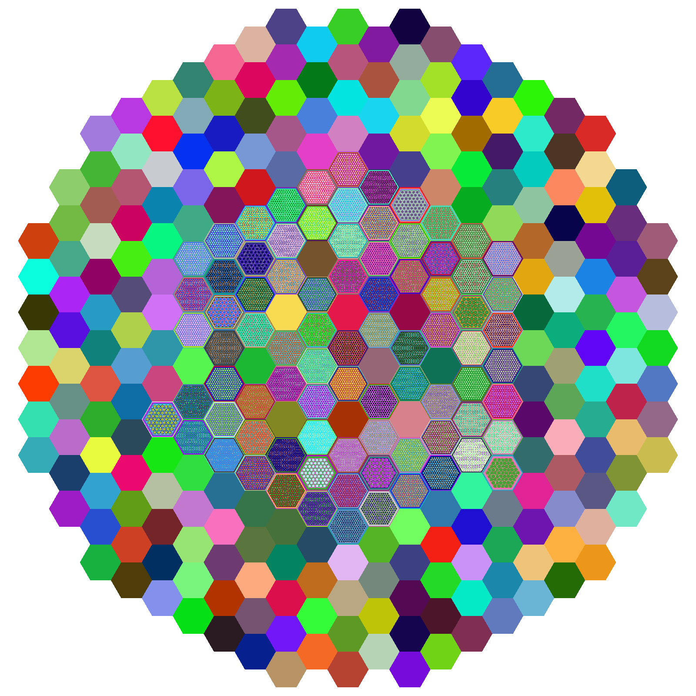

ARMI + OpenMC
=============

**armi-openmc** is an `ARMI <https://partofthething.github.io/armi/>`_ plugin that turns an ARMI
reactor model into an `OpenMC <https://docs.openmc.org>`_ Monte Carlo model, runs it, and puts the
results back on the reactor. It works with the partofthething fork of ARMI (2.0 and later). The
source, issues and examples are at `partofthething/armi-openmc-plugin
<https://github.com/partofthething/armi-openmc-plugin>`_.

It does two jobs:

Global flux (``neutronicsKernel: OpenMC``)
   A whole-core eigenvalue run at every time node. Hexagonal and Cartesian cores, each block pin
   by pin or homogenized. keff with its standard deviation, block power, power density, flux and
   multigroup flux, and optionally pin powers, land on the ARMI blocks.

Cross sections (``xsKernel: OpenMC``)
   For each cross section group, a model of its representative block, alone in an infinite
   lattice or in a colorset with its driver. Tallies are reduced to microscopic multigroup cross
   sections and written as an ISOTXS library any ARMI flux solver can read.

.. note::

   This plugin, its documentation and its benchmark analyses were made with large language models
   (Anthropic's Claude) under the direction of a human developer. Check any result that matters
   to you against independent calculations, as you would with any code.

   The FFTF core as the plugin builds it from the ARMI inputs: 313 assemblies, with fuel and
   absorber assemblies pin by pin. Colors are OpenMC's per-material plot colors.

Quick start
-----------

.. code-block:: bash

   python -m armi_openmc run case.yaml      # an ARMI run with the plugin loaded
   python -m armi_openmc gui case.yaml      # the input editor, with an OpenMC section and a Run button

Set ``neutronicsKernel: OpenMC`` (or ``xsKernel: OpenMC``) and point ``openmcCrossSections`` at a
``cross_sections.xml``. The :doc:`benchmarks` page shows what that gives on C5G7, FFTF and an
MC2-3 cross section library.

.. toctree::
   :maxdepth: 2
   :caption: Using it

   installation
   usage
   settings
   triso

.. toctree::
   :maxdepth: 2
   :caption: How it works

   modeling
   crosssections

.. toctree::
   :maxdepth: 2
   :caption: Results and plans

   benchmarks
   roadmap

.. toctree::
   :maxdepth: 1
   :caption: Reference

   api
