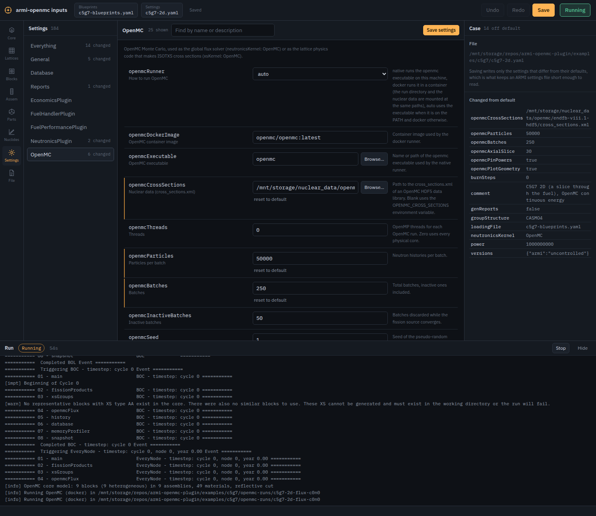
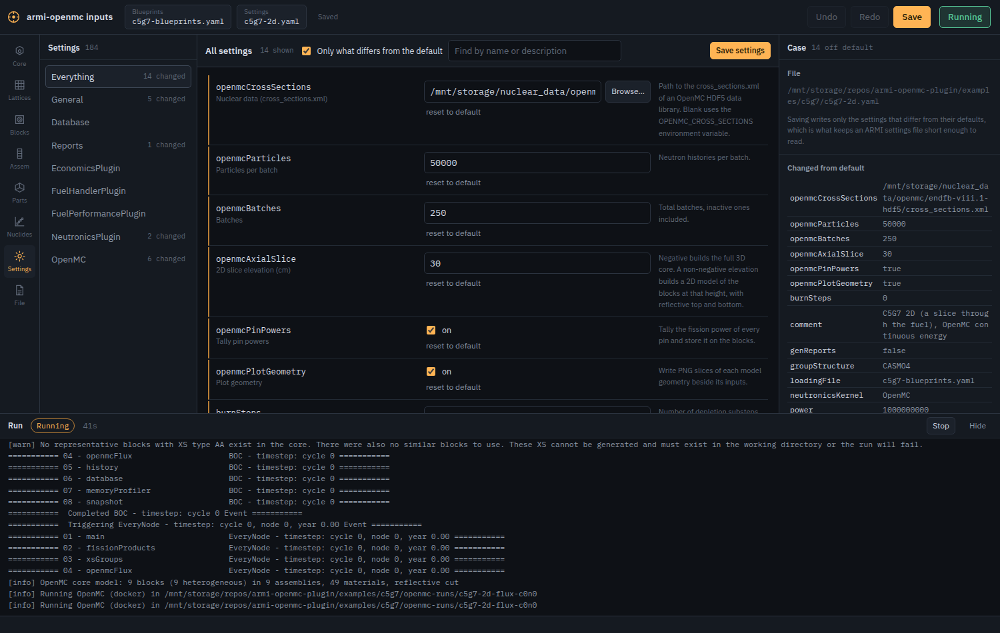

Using the plugin
================

The plugin registers with any ARMI application. ``python -m armi_openmc`` is ARMI's command
line with the plugin already loaded; an application of your own registers
``armi_openmc.plugin.OpenMCPlugin`` the usual way.

Global flux
-----------

Set ``neutronicsKernel: OpenMC`` and run the case as usual:

.. code-block:: yaml

   settings:
     loadingFile: blueprints.yaml
     power: 400000000.0
     neutronicsKernel: OpenMC
     openmcCrossSections: /path/to/endfb-viii.1-hdf5/cross_sections.xml
     openmcParticles: 40000
     openmcBatches: 200
     openmcInactiveBatches: 50
     openmcBlockModel: heterogeneous
     openmcHeterogeneousBlockFlags: [fuel, control]   # empty: every block in detail

At every time node the interface builds the model, runs it in its own folder under
``openmcRunDir`` (``model.xml``, the statepoint, ``openmc.out`` and, with ``openmcPlotGeometry``,
PNG slices), and sets on the reactor:

* ``core.p.keff`` and ``core.p.openmcKeffStdDev``;
* block ``power``, ``pdens``, ``flux`` and ``mgFlux`` (volume-integrated, ARMI group order, in
  the ``groupStructure`` of the case or ``openmcGroupStructure``);
* with ``openmcPinPowers``, ``linPowByPin`` (W/cm, ordered like ``Block.getPinLocations``) and
  ``openmcPinPowers`` / ``openmcPinIndices`` (W per pin, with its block grid indices).

Results are normalized so that the fission energy tallied in the model equals the case's
``power`` (scaled to the modeled fraction of the core); see :doc:`modeling`.

OpenMC's batch output is echoed into the ARMI log as ``[openmc]`` lines, so a terminal, a log file
and the input editor's console all show the run converging.

Cross sections
--------------

Set ``xsKernel: OpenMC`` (with ``genXS: Neutron``) and the lattice physics interface makes the
ISOTXS for every cross section group the ARMI cross section group manager defines. A group whose
cross section settings name a ``driverID`` is modeled surrounded by its driver when
``openmcXSColorset`` is on. :doc:`crosssections` explains the models and the reduction.

Command line
------------

.. code-block:: bash

   python -m armi_openmc openmc-core case.yaml [--no-run] [--plot] [--label NAME]
   python -m armi_openmc openmc-xs   case.yaml [--xs-ids AA BA] [--compare OTHER_ISOTXS]
   python -m armi_openmc compare-xs  REFERENCE_ISOTXS OTHER_ISOTXS [--flux FLUX.json]

``openmc-core`` builds (and runs) the whole-core model of a case and writes ``results.json``
with keff, assembly and block powers, and pin powers. ``openmc-xs`` makes an ISOTXS outside a
full run. ``compare-xs`` compares two libraries nuclide by nuclide, collapsing with the group flux
the OpenMC library was made with (``<library>.flux.json``, written beside it).

The input editor
----------------

``python -m armi_openmc gui case.yaml`` opens ARMI's browser-based input editor with the plugin
loaded. The plugin's settings form their own **OpenMC** section, ordered, described, and shown
only when relevant (the executable only for the native runner, the block flags only for the
heterogeneous model).

   The OpenMC settings of the 2D C5G7 case in the input editor.

**Run** (Ctrl+Enter) runs the open case with the same application, here with the plugin, and
follows its log in a console docked under the workspace, with the elapsed time and a Stop
button. Unsaved edits are saved first, since a run reads the files on disk.

   A C5G7 run started from the editor.
